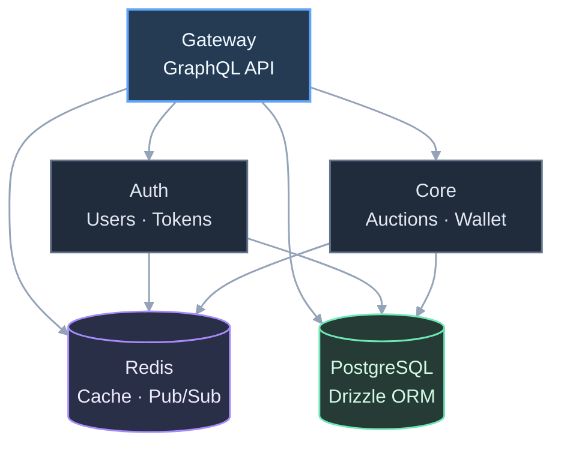

# 🎯 Live Bid

یک پلتفرم مزایده آنلاین و بلادرنگ که کاربران می‌توانند در آن مزایده ایجاد کنند، در مزایده‌های فعال شرکت کنند، کیف پول خود را مدیریت کنند و پروفایل شخصی بسازند.

قابلیت گفت‌وگو (Chat) برای هر مزایده نیز در برنامه توسعه نسخه‌های آینده قرار دارد.

> ⚠️ **وضعیت پروژه:** در مراحل اولیه توسعه — قابلیت‌ها و معماری پروژه همچنان در حال تکامل هستند.

---

## 📁 Project Structure

این پروژه از ساختار Monorepo استفاده می‌کند و شامل اپلیکیشن‌های Backend، کلاینت‌های Frontend، پکیج‌های مشترک و زیرساخت موردنیاز است.

```text
live-bid/
├── apps/           # Backend microservices (auth, core, gateway)
├── clients/        # Frontend applications
│   └── web/        # Next.js web client
├── packages/       # Shared libraries
│   ├── contracts/  # Shared between client & server (Zod schemas, enums)
│   └── services/   # Shared between backend services only
├── infra/          # Docker & infrastructure
└── migrations/     # Database migrations
```

### 📦 Shared Packages

پروژه از دو پکیج مشترک برای مدیریت قراردادها و منطق داخلی Backend استفاده می‌کند:

| Package | Usage | Description |
|---|---|---|
| `@live-bid/contracts` | Client + Server | منبع اصلی و یکپارچه برای Zod schemas، enums و انواع داده مشترک |
| `@live-bid/services` | Backend services | شامل Database schema (Drizzle)، Cache، Message Patterns و انواع داده داخلی سرویس‌ها |

**قانون کلی:**

- هر چیزی که هم Client و هم Server به آن نیاز دارند، مانند قوانین اعتبارسنجی و Enumها، در `contracts/` قرار می‌گیرد.
- موارد مختص Backend، مانند Database schema و ارتباطات داخلی سرویس‌ها، در `services/` قرار می‌گیرند.

---

## 🌐 Client — Web

کلاینت وب با استفاده از Next.js توسعه داده شده و از طریق Apollo Client و GraphQL با Backend ارتباط برقرار می‌کند.

**Core Technologies:**
- Next.js 16 (App Router)
- React 19
- Tailwind CSS 4
- shadcn/ui
- Apollo Client (GraphQL)

### 📂 Structure

```text
clients/web/src/
├── app/            # Next.js App Router
│   ├── (dashboard)/   # Authenticated dashboard routes
│   └── (pages)/       # Public pages
├── Components/     # Layout, providers, UI kit
├── feature/        # Feature modules (Auth, Dashboard, Home)
├── hooks/          # Shared hooks
├── lib/            # Apollo client, utils
└── mocks/          # Static mock data
```

### ✨ Key Features

- **Auth:** پنجره‌های ورود و ثبت‌نام با استفاده از GraphQL Mutations
- **Dashboard:** مدیریت کیف پول، علاقه‌مندی‌ها، مزایده‌های برنده‌شده و تنظیمات حساب کاربری
- **Home:** بخش معرفی، کارت‌های مزایده زنده، راهنمای استفاده و سوالات متداول
- **UI Kit:** مجموعه‌ای از کامپوننت‌های قابل استفاده مجدد که مستندات آن‌ها با Storybook ارائه شده است؛ مانند `badge`، `button`، `card` و `dialog`.

### 🛠️ Client Tech Stack

| Technology | Version | Purpose |
|---|---|---|
| `next` | `^16.3.6` | فریم‌ورک React با App Router |
| `react` | `19.2.8` | کتابخانه رابط کاربری |
| `typescript` | `^5` | Type Safety |
| `tailwindcss` | `^4` | طراحی رابط کاربری با Utility Classes |
| `shadcn` | `^4.21.0` | سیستم کامپوننت‌های رابط کاربری |
| `@base-ui/react` | `^1.8.0` | Headless UI Primitives |
| `framer-motion` | `^13.1.1` | انیمیشن و تعاملات رابط کاربری |
| `lucide-react` | `^1.34.0` | مجموعه آیکون‌ها |
| `recharts` | `^3.8.0` | رسم نمودارها |
| `sonner` | `^2.0.8` | نمایش اعلان‌ها و Toastها |
| `date-fns` | `^4.4.0` | مدیریت و پردازش تاریخ |
| `@live-bid/contracts` | `*` | Schemaها و Typeهای مشترک |

### 🔧 Development Tools

| Tool | Version | Purpose |
|---|---|---|
| `storybook` | `^10.6.0` | توسعه و مستندسازی کامپوننت‌ها |
| `vitest` | `latest` | تست واحد |
| `playwright` | `latest` | تست مرورگر |
| `eslint` | `^9` | بررسی و یکپارچه‌سازی کد |

### 🚀 Getting Started

```bash
cd clients/web

# Install dependencies
npm install

# Start development server
npm run dev

# Open Storybook
npm run storybook
```

- Web Client: `http://localhost:3000`
- Storybook: `http://localhost:6006`

---

## ⚙️ Server — Backend

Backend پروژه بر پایه معماری Microservices و با استفاده از NestJS توسعه داده شده است.

این معماری از سه سرویس مستقل تشکیل شده است: `Gateway`، `Auth` و `Core`.

سرویس Gateway رابط عمومی GraphQL را در اختیار کلاینت قرار می‌دهد و ارتباط داخلی بین Microserviceها از طریق NestJS `ClientProxy` و Message Patternها انجام می‌شود.

همچنین Redis برای Cache و Pub/Sub و PostgreSQL به‌عنوان دیتابیس اصلی پروژه استفاده می‌شوند.

برای مشاهده مستندات کامل Backend:

- [README.server.md](README.server.md) — مستندات کامل Backend
- [apps/README.md](apps/README.md) — معرفی سرویس‌ها و ساختار آن‌ها

### 🏗️ Architecture



### 🧩 Backend Services

| Service | Responsibility |
|---|---|
| `gateway` | GraphQL API عمومی، احراز هویت، Guards، Cache، Rate Limiting و WebSocket |
| `auth` | ثبت‌نام و ورود کاربران، مدیریت JWT، Refresh Token و Roleها |
| `core` | منطق اصلی دامنه شامل مزایده‌ها و کیف پول — در حال حاضر حداقلی |

### 📂 Structure

```text
apps/
├── gateway/        # Apollo GraphQL + guards, interceptors, WS
├── auth/           # Auth module, users, tokens
└── core/           # (future) auctions, wallet, chat

packages/
├── contracts/      # Shared Zod schemas, enums (client + server)
└── services/       # DB schema, cache, messaging, internal types
```

### 🛠️ Backend Tech Stack

| Technology | Version | Purpose |
|---|---|---|
| `@nestjs/core` | `^11.0.1` | فریم‌ورک اصلی Backend |
| `@nestjs/graphql` | `^13.4.4` | پیاده‌سازی GraphQL به روش Code-First |
| `@apollo/server` | `^5.5.1` | GraphQL Server |
| `@nestjs/websockets` | `^11.1.29` | قابلیت‌های Real-time با Socket.IO |
| `graphql-ws` | `^6.2.1` | پشتیبانی از GraphQL Subscriptions روی WebSocket |
| `graphql-redis-subscriptions` | `^2.7.0` | Redis-backed PubSub برای Subscriptionها |
| `@nestjs/jwt` | `^11.0.2` | احراز هویت مبتنی بر JWT |
| `@nestjs/passport` | `^11.0.5` | لایه مدیریت استراتژی‌های احراز هویت |
| `bcrypt` | `^6.0.0` | Hash کردن رمز عبور |
| `drizzle-orm` | `^0.45.2` | ORM تایپ‌سیف برای PostgreSQL |
| `pg` | `^8.23.0` | درایور PostgreSQL |
| `ioredis` | `^6.0.0` | ارتباط با Redis برای Cache و Pub/Sub |
| `zod` | `^4.4.3` | اعتبارسنجی Schemaها |
| `nestjs-zod` | `^5.5.0` | یکپارچه‌سازی Zod با NestJS |
| `@nestjs/throttler` | `^6.5.0` | مدیریت Rate Limiting |
| `nestjs-pino` | `^4.6.1` | Structured Logging |
| `helmet` | `^8.3.0` | افزودن HTTP Security Headers |
| `geoip-lite` | `^2.0.3` | تشخیص موقعیت جغرافیایی IP |
| `ua-parser-js` | `^2.0.10` | شناسایی مرورگر و دستگاه کاربر |

### 🔧 Development Tools

| Tool | Version | Purpose |
|---|---|---|
| `drizzle-kit` | `^0.31.10` | مدیریت Migrationها و Drizzle Studio |
| `concurrently` | `^10.0.4` | اجرای هم‌زمان سرویس‌ها |
| `pino-pretty` | `^13.1.3` | خواناتر کردن خروجی Logها |
| `typescript` | `^5.7.3` | Type Safety |

### 🚀 Getting Started

**Prerequisites**

قبل از اجرای پروژه، موارد زیر باید نصب و آماده باشند:

- Node.js `^20+`
- PostgreSQL
- Redis
- Docker و Docker Compose

**Installation & Setup**

```bash
# 1. Install all workspace dependencies
npm install

# 2. Start infrastructure (Postgres + Redis)
docker compose -f infra/docker-compose.yaml up -d

# 3. Apply database migrations
npm run db:migrate-dev

# 4. Build shared packages & start everything
npm run dev
```

سرویس Gateway روی پورتی که در تنظیمات پروژه مشخص شده اجرا می‌شود.

برای مشاهده یا تغییر تنظیمات، فایل زیر را بررسی کنید:

`apps/gateway/src/lib/configs/env.ts`

### 📜 Useful Scripts

```bash
# Development
npm run dev:microservices    # gateway + auth + core + packages
npm run dev:all              # above + web client

# Database
npm run db:generate          # generate migration from schema
npm run db:migrate-dev       # apply migrations
npm run db:push              # push schema directly (dev)
npm run db:studio            # open Drizzle Studio

# Build
npm run build:all            # build all apps & packages
```

### ✨ Backend Highlights

- **Zod-First Contracts:** استفاده از Schemaهای مشترک Zod بین Client و Server از طریق `@live-bid/contracts`
- **GraphQL Complexity Limits:** محدودسازی پیچیدگی Queryها با `graphql-query-complexity` برای جلوگیری از Queryهای بیش از حد سنگین
- **Redis Pub/Sub:** استفاده از Redis Pub/Sub برای پشتیبانی از GraphQL Subscriptions و ارسال به‌روزرسانی‌های زنده مزایده‌ها
- **Token Management:** استفاده از JWT Access Token و Cookie-based Refresh Token
- **Client Info Tracking:** ثبت اطلاعات کلاینت شامل IP، نوع دستگاه و موقعیت جغرافیایی با استفاده از Custom Decoratorها
- **Rate Limiting:** محدودسازی تعداد درخواست‌ها و عملیات با استفاده از `@nestjs/throttler`

### 🔄 Inter-Service Communication

ارتباط بین Microserviceها از طریق NestJS `ClientProxy` و با استفاده از Message Patternهایی انجام می‌شود که در مسیر زیر تعریف شده‌اند:

`packages/services/src/messages/`

**Example:**

```typescript
// packages/services/src/messages/auth.messages.ts

export const AUTH_PATTERNS = {
  REGISTER: "auth.register",
  LOGIN: "auth.login",
  VALIDATE_REFRESH_TOKEN: "auth.vaildate_refresh_token",
  REFRESH: "auth.refresh",
  LOGOUT: "auth.logout",
} as const;
```

**Service Identifiers & Token Names:**

```typescript
// service.names.ts

export const CORE_SERVICE_NAME = "CORE_SERVICE";
export const AUTH_SERVICE_NAME = "AUTH_SERVICE";

// token.names.ts — cookie names used for auth

export const ACCESS_TOKEN_NAME = "accessToken";
export const REFRESH_TOKEN_NAME = "refreshToken";
```

Request و Response Typeهای مشترک بین سرویس‌ها نیز در مسیر زیر نگهداری می‌شوند:

`packages/services/src/types/`

---

## 📖 Development Guidelines

این بخش یک راهنمای سریع برای توسعه قابلیت‌های جدید و مشخص کردن محل قرارگیری کدها در پروژه است.

رعایت این ساختار کمک می‌کند قراردادهای Client و Server هماهنگ باقی بمانند و توسعه قابلیت‌های جدید ساده‌تر و قابل نگهداری‌تر باشد.

### 🧭 Adding a New Endpoint (GraphQL)

هنگام اضافه کردن یک Endpoint جدید، بخش‌های مرتبط باید در مسیرهای زیر تعریف شوند:

| Concern | Location |
|---|---|
| Zod Schema (Validation) | `packages/contracts/src/schemas/<domain>/<action>.schema.ts` |
| Enum (Shared Values) | `packages/contracts/src/enums/<name>.enum.ts` |
| DB Table (Drizzle) | `packages/services/src/database/schema/<table>.schema.ts` |
| Message Pattern | `packages/services/src/messages/<service>.messages.ts` |
| Request / Response Types | `packages/services/src/types/services-request/` و `services-response/` |
| Resolver (Gateway) | `apps/gateway/src/graphql/resolvers/<domain>/` |
| Resolver Input / Output | `.../resolvers/<domain>/<domain>/inputs/` و `outputs/` |

### 🔐 Authentication Flow

فرآیند احراز هویت به‌صورت کلی از مسیر زیر عبور می‌کند:

```text
Client mutation
  ↓
gateway AuthResolver      ← ZodPipe validates input against contracts schema
  ↓ (ClientProxy.send)
auth AuthService          ← business logic + JWT
  ↓ (Drizzle)
PostgreSQL
```

### 🧱 Contract Schema

ابتدا Schema مربوط به ورودی را در پکیج `contracts` تعریف می‌کنیم تا قوانین اعتبارسنجی بین Client و Server مشترک باشند.

**Example:**

```typescript
export const LoginUserSchema = z.object({
  username: UsernameSchema.optional(),
  email: z.email().optional(),
  password: UserPasswordSchema,
  remember: z.boolean().optional().default(false),
}).refine(
  data => data.username || data.email,
  {message: "Either username or email is required", path: ["username", "email"]}
);
```

### 📥 GraphQL Input

سپس Input مربوط به GraphQL را در Gateway تعریف می‌کنیم:

```typescript
@InputType()
export class LoginUserInput {
  @Field(() => String, {nullable: true}) email?: string;
  @Field(() => String, {nullable: true}) username?: string;
  @Field(() => String) password: string;
  @Field(() => Boolean, {nullable: true, defaultValue: false}) remember?: boolean;
}
```

> 💡 **نکته:** کلاس‌های GraphQL `@InputType` که در مسیر `resolvers/.../inputs/` قرار می‌گیرند، با Zod Schemaها متفاوت هستند.
>
> Input Typeها ساختار API و ورودی‌های GraphQL را تعریف می‌کنند، در حالی که Zod Schemaها مسئول اعتبارسنجی داده‌ها در زمان اجرا هستند.
>
> هر دو باید با قرارداد مشترک تعریف‌شده در `contracts` هماهنگ باقی بمانند.

### 🗄️ Database Schema

ساختار جدول دیتابیس با استفاده از Drizzle ORM در پکیج `services` تعریف می‌شود.

**Example:**

```typescript
export const user = pgTable("users", {
  ...baseDrizzleTable,   // id, created_at, updated_at
  password: varchar("password", {length: 255}).notNull(),
  email: varchar("email").notNull().unique(),
  username: varchar("username", {length: 255}).unique(),
  is_active: boolean("is_active").default(true).notNull(),
  display_name: varchar("display_name", {length: 60}).notNull(),
  role: userRoleEnum('role').notNull().default(UserRoleEnum.USER),
});
```

### ✅ Setup Checklist

برای اضافه کردن یک قابلیت جدید، مراحل زیر را دنبال کنید:

1. **Contract:** تعریف Zod Schema و Enumهای موردنیاز در `packages/contracts`
2. **Database:** تعریف جدول Drizzle در `packages/services/src/database/schema/`
3. **Migration:** اجرای دستورات `npm run db:generate` و `npm run db:migrate-dev`
4. **Message Pattern:** تعریف الگوی ارتباطی در `packages/services/src/messages/`
5. **Types:** تعریف Request و Response Typeها در `packages/services/src/types/`
6. **Service:** پیاده‌سازی منطق اصلی در Microservice مربوطه، مانند `apps/auth` یا `apps/core`
7. **Gateway Resolver:** در دسترس قرار دادن قابلیت از طریق GraphQL در `apps/gateway/src/graphql/resolvers/`
8. **Client:** استفاده از API جدید در کلاینت وب از طریق Apollo Client

---

## 🗺️ Roadmap

وضعیت فعلی و برنامه توسعه قابلیت‌های پروژه:

- [x] احراز هویت کاربران (JWT + Refresh Tokens)
- [x] رابط کاربری کیف پول و داشبورد
- [ ] ایجاد مزایده و ثبت پیشنهاد قیمت به‌صورت زنده (Core Service)
- [ ] گفت‌وگوی اختصاصی برای هر مزایده (WebSocket)
- [ ] پنل مدیریت (Admin Panel)

---

## 🤝 Contributing

از مشارکت در توسعه پروژه استقبال می‌کنیم.

برای مشارکت، مراحل زیر را دنبال کنید:

1. پروژه را Fork و Clone کنید.
2. یک Branch جدید ایجاد کنید:

   ```bash
   git checkout -b feat/your-feature
   ```

3. تغییرات خود را Commit کنید:

   ```bash
   git commit -m 'feat: add feature'
   ```

4. تغییرات را Push کرده و یک Pull Request ایجاد کنید.

---

## 📚 Additional Documentation

برای مطالعه جزئیات بیشتر درباره ساختار و معماری Backend، مستندات زیر را بررسی کنید:

- [README.server.md](README.server.md) — مستندات کامل Backend و معماری آن
- [apps/README.md](apps/README.md) — راهنمای سرویس‌ها و ساختار داخلی آن‌ها

---

**Built with ❤️ using NestJS, Next.js, PostgreSQL, and Redis.**
