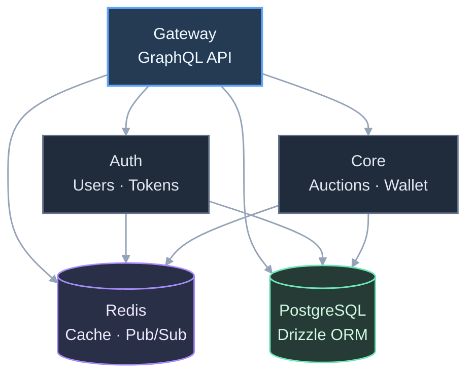

# 🎯 Live Bid

A real-time auction platform where users can create and participate in live auctions, manage their wallets, and build their profiles. Per-auction chat functionality is planned for
future releases.

> ⚠️ **Status:** Early development — features and architecture are still evolving.

---

## 📦 Monorepo Structure

```text
live-bid/
├── apps/           # Backend microservices (auth, core, gateway)
├── clients/        # Frontend applications
│   └── web/        # Next.js web client
├── packages/       # Shared libraries
│   ├── contracts/  # Shared client-server contracts (Zod schemas, enums)
│   └── services/   # Backend-only shared libraries
├── infra/          # Docker and infrastructure configuration
└── migrations/     # Database migrations
```

### 📚 Shared Packages

| Package                 | Used By          | Purpose                                                                          |
|-------------------------|------------------|----------------------------------------------------------------------------------|
| **@live-bid/contracts** | Client + Server  | Single source of truth for Zod schemas, enums, and shared types                  |
| **@live-bid/services**  | Backend services | Database schema (Drizzle), caching, message patterns, and internal service types |

> **Rule of thumb:** Anything the client needs to know (validation rules, enums, shared types) belongs in `contracts/`. Anything backend-specific (database schema, internal
> messaging, service types) belongs in `services/`.

---

# 🖥️ Client — Web

The web client is a **Next.js 16** application built with the App Router, **React 19**, **Tailwind CSS 4**, and **shadcn/ui** for UI components. It communicates with the backend
through **Apollo Client (GraphQL)**.

## 📁 Structure

```text
clients/web/src/
├── app/               # Next.js App Router
│   ├── (dashboard)/   # Authenticated dashboard routes
│   └── (pages)/       # Public pages
├── Components/        # Layout, providers, and UI components
├── featuer/           # Feature modules (Auth, Dashboard, Home)
├── hooks/             # Shared React hooks
├── lib/               # Apollo Client configuration and utilities
└── mocks/             # Static mock data
```

## 🧩 Key Features

- **Auth** — Login and registration modals powered by GraphQL mutations
- **Dashboard** — Wallet, Favorites, Won Auctions, and Settings
- **Home** — Hero section, live auction cards, How It Works, and FAQ
- **UI Kit** — Storybook-documented components (`badge`, `button`, `card`, `dialog`, etc.)

## 📚 Tech Stack

| Tech                    | Version | Description                   |
|-------------------------|---------|-------------------------------|
| **next**                | ^16.3.6 | React framework (App Router)  |
| **react**               | 19.2.8  | UI library                    |
| **typescript**          | ^5      | Type safety                   |
| **tailwindcss**         | ^4      | Utility-first CSS framework   |
| **shadcn**              | ^4.21.0 | Component system              |
| **@base-ui/react**      | ^1.8.0  | Headless UI primitives        |
| **framer-motion**       | ^13.1.1 | Animations                    |
| **lucide-react**        | ^1.34.0 | Icon library                  |
| **recharts**            | ^3.8.0  | Charts and data visualization |
| **sonner**              | ^2.0.8  | Toast notifications           |
| **date-fns**            | ^4.4.0  | Date utilities                |
| **@live-bid/contracts** | *       | Shared schemas and types      |

### 🛠️ Dev Tools

| Tech           | Version | Description                             |
|----------------|---------|-----------------------------------------|
| **storybook**  | ^10.6.0 | Component development and documentation |
| **vitest**     | latest  | Unit testing                            |
| **playwright** | latest  | Browser and end-to-end testing          |
| **eslint**     | ^9      | Linting                                 |

## 🚀 Getting Started

```bash
cd clients/web

npm install
npm run dev          # http://localhost:3000
npm run storybook    # http://localhost:6006
```

---

# ⚙️ Server — Backend

The backend follows a **NestJS microservices architecture** composed of three independent services: Gateway, Auth, and Core.

The Gateway exposes the public GraphQL API and communicates with internal services through NestJS `ClientProxy` using message patterns. Redis provides caching and Pub/Sub
capabilities, while PostgreSQL serves as the primary datastore.

> 📖 For full backend documentation, see [`README.SERVER.md`](README.SERVER.md).  
> 📖 For the service map, see [`apps/README.md`](./apps/README.md).

## 🏗️ Architecture

<!-- @formatter:off -->

<!-- @formatter:on -->

| Service | Responsibility |
|---|---|
| **gateway** | Public GraphQL API, authentication guards, caching, throttling, and WebSocket connections |
| **auth** | User registration, login, JWT and refresh tokens, and role management |
| **core** | Domain logic (auctions and wallet) — *currently minimal* |

## 📁 Structure

```text
apps/
├── gateway/        # Apollo GraphQL, guards, interceptors, and WebSockets
├── auth/           # Authentication module, users, and tokens
└── core/           # Auction, wallet, and future chat functionality

packages/
├── contracts/      # Shared Zod schemas and enums (client + server)
└── services/       # Database schema, caching, messaging, and internal types
```

## 📚 Tech Stack

| Tech | Version | Description |
|---|---|---|
| **@nestjs/core** | ^11.0.1 | Backend framework |
| **@nestjs/graphql** | ^13.4.4 | GraphQL integration (code-first) |
| **@apollo/server** | ^5.5.1 | GraphQL server |
| **@nestjs/websockets** | ^11.1.29 | Real-time communication (Socket.IO) |
| **graphql-ws** | ^6.2.1 | GraphQL subscriptions over WebSockets |
| **graphql-redis-subscriptions** | ^2.7.0 | Redis-backed Pub/Sub for subscriptions |
| **@nestjs/jwt** | ^11.0.2 | JWT authentication |
| **@nestjs/passport** | ^11.0.5 | Passport authentication integration |
| **bcrypt** | ^6.0.0 | Password hashing |
| **drizzle-orm** | ^0.45.2 | Type-safe ORM for PostgreSQL |
| **pg** | ^8.23.0 | PostgreSQL driver |
| **ioredis** | ^6.0.0 | Redis client (caching + Pub/Sub) |
| **zod** | ^4.4.3 | Schema validation |
| **nestjs-zod** | ^5.5.0 | Zod integration for NestJS |
| **@nestjs/throttler** | ^6.5.0 | Rate limiting |
| **nestjs-pino** | ^4.6.1 | Structured logging |
| **helmet** | ^8.3.0 | HTTP security headers |
| **geoip-lite** | ^2.0.3 | IP geolocation |
| **ua-parser-js** | ^2.0.10 | User-agent and device detection |

### 🛠️ Dev Tools

| Tech | Version | Description |
|---|---|---|
| **drizzle-kit** | ^0.31.10 | Database migrations and Drizzle Studio |
| **concurrently** | ^10.0.4 | Run multiple processes together |
| **pino-pretty** | ^13.1.3 | Pretty-printed log output |
| **typescript** | ^5.7.3 | Type safety |

## 🚀 Getting Started

### Prerequisites

- **Node.js** `^20+`
- **PostgreSQL**
- **Redis**
- **Docker** and Docker Compose (for local infrastructure)

### Setup

Run the following commands from the repository root:

```bash
# 1. Install workspace dependencies
npm install

# 2. Start infrastructure (PostgreSQL + Redis)
docker compose -f infra/docker-compose.yaml up -d

# 3. Apply database migrations
npm run db:migrate-dev

# 4. Build shared packages and start all backend services
npm run dev
```

The Gateway runs on its configured port. See `apps/gateway/src/lib/configs/env.ts` for the relevant environment configuration.

### Useful Scripts

```bash
# Development
npm run dev:microservices    # Gateway + Auth + Core + shared packages
npm run dev:all              # Above + Web client

# Database
npm run db:generate          # Generate migrations from the schema
npm run db:migrate-dev       # Apply database migrations
npm run db:push              # Push schema changes directly (development only)
npm run db:studio            # Open Drizzle Studio

# Build
npm run build:all            # Build all applications and packages
```

## 🔐 Highlights

- **Zod-first contracts** — Shared schemas between client and server via `@live-bid/contracts`
- **GraphQL complexity limits** — `graphql-query-complexity` helps prevent excessively complex queries
- **Redis Pub/Sub** — Enables GraphQL subscriptions for real-time auction updates
- **Cookie-based refresh tokens** — Refresh tokens are stored in cookies alongside JWT access tokens
- **Client info tracking** — IP, device, and geolocation information through custom decorators
- **Rate limiting** — Per-operation throttling using `@nestjs/throttler`

## 🔌 Inter-Service Communication

Internal microservices communicate through **NestJS `ClientProxy`**, using message patterns defined in `packages/services/src/messages/`.

```ts
// packages/services/src/messages/auth.messages.ts
export const AUTH_PATTERNS = {
  REGISTER: "auth.register",
  LOGIN: "auth.login",
  VALIDATE_REFRESH_TOKEN: "auth.vaildate_refresh_token",
  REFRESH: "auth.refresh",
  LOGOUT: "auth.logout",
} as const;
```

Service identifiers are defined in `packages/services/src/names/`:

```ts
// service.names.ts
export const CORE_SERVICE_NAME = "CORE_SERVICE";
export const AUTH_SERVICE_NAME = "AUTH_SERVICE";

// token.names.ts — Cookie names used for authentication
export const ACCESS_TOKEN_NAME = "accessToken";
export const REFRESH_TOKEN_NAME = "refreshToken";
```

Request and response types shared between services are defined in `packages/services/src/types/`.

---

## 📖 Development Guidelines

A quick reference for where to place code when implementing new features. Following these conventions helps keep the client and server consistent.

### Adding a New Endpoint (GraphQL)

| Concern | Location |
|---|---|
| **Zod schema** (validation) | `packages/contracts/src/schemas/<domain>/<action>.schema.ts` |
| **Enum** (shared values) | `packages/contracts/src/enums/<name>.enum.ts` |
| **DB table** (Drizzle) | `packages/services/src/database/schema/<table>.schema.ts` |
| **Message pattern** | `packages/services/src/messages/<service>.messages.ts` |
| **Request/Response types** | `packages/services/src/types/services-request/` and `services-response/` |
| **Resolver** (Gateway) | `apps/gateway/src/graphql/resolvers/<domain>/` |
| **Resolver Input/Output** | `.../resolvers/<domain>/<domain>/inputs/` and `outputs/` |

### Example: The Auth Flow

```text
Client mutation
      ↓
Gateway AuthResolver      ← ZodPipe validates input against the contracts schema
      ↓ (ClientProxy.send)
Auth AuthService          ← Business logic + JWT
      ↓ (Drizzle)
PostgreSQL
```

**Contract schema** (`contracts/schemas/auth/login.schema.ts`):

```ts
export const LoginUserSchema = z.object({
  username: UsernameSchema.optional(),
  email: z.email().optional(),
  password: UserPasswordSchema,
  remember: z.boolean().optional().default(false),
}).refine(
  data => data.username || data.email,
  {
    message: "Either username or email is required",
    path: ["username", "email"],
  }
);
```

**GraphQL Input** (`gateway/.../auth/inputs/login.input.ts`):

```ts
@InputType()
export class LoginUserInput {
  @Field(() => String, {nullable: true})
  email?: string;

  @Field(() => String, {nullable: true})
  username?: string;

  @Field(() => String)
  password: string;

  @Field(() => Boolean, {nullable: true, defaultValue: false})
  remember?: boolean;
}
```

> 💡 **Note:** GraphQL `@InputType` classes (in `resolvers/.../inputs/`) are different from Zod schemas. Input types define the GraphQL API surface, while Zod schemas enforce
> runtime validation. Both must remain consistent with the shared contract.

**Database table** (`services/database/schema/user.schema.ts`):

```ts
export const user = pgTable("users", {
  ...baseDrizzleTable,   // id, created_at, updated_at
  password: varchar("password", {length: 255}).notNull(),
  email: varchar("email").notNull().unique(),
  username: varchar("username", {length: 255}).unique(),
  is_active: boolean("is_active").default(true).notNull(),
  display_name: varchar("display_name", {length: 60}).notNull(),
  role: userRoleEnum("role").notNull().default(UserRoleEnum.USER),
});
```

### Setup Checklist for a New Feature

1. **Contract** — Define the Zod schema and enum in `packages/contracts/`.
2. **DB** — Define the Drizzle table in `packages/services/src/database/schema/`.
3. **Migration** — Run `npm run db:generate` and `npm run db:migrate-dev`.
4. **Message pattern** — Add the message pattern to `packages/services/src/messages/`.
5. **Types** — Define request and response types in `packages/services/src/types/`.
6. **Service** — Implement the business logic in the target microservice (`apps/auth/`, `apps/core/`).
7. **Gateway resolver** — Expose the functionality through GraphQL in `apps/gateway/src/graphql/resolvers/`.
8. **Client** — Consume the API through Apollo Client in `clients/web/`.

---

## 🗺️ Roadmap

- [x] User authentication (JWT + refresh tokens)
- [x] Wallet and dashboard UI
- [ ] Live auction creation and bidding (Core service)
- [ ] Per-auction chat (WebSockets)
- [ ] Admin panel

---

## 🤝 Contributing

1. Fork and clone the repository.
2. Create a feature branch: `git checkout -b feat/your-feature`
3. Commit your changes: `git commit -m 'feat: add feature'`
4. Push your branch and open a Pull Request.

---

> 📖 For full backend documentation, see [`README.SERVER.md`](README.SERVER.md).  
> 📖 For the service map, see [`apps/README.md`](./apps/README.md).

## **Contributors**

### 👨‍💻 Project Contributors

A clean and modern full‑stack collaboration.

<br>

<table>
  <tr>
    <td align="center">
      <br>
      <b>Homayoun</b><br>
      <sub>Backend Developer · Server‑Side</sub><br>
      <a href="https://github.com/homow">github.com/homow</a>
    </td>
    <td align="center">
      <br>
      <b>mardi‑niyayesh</b><br>
      <sub>Frontend Developer · Client‑Side</sub><br>
      <a href="https://github.com/mardi-niyayesh">github.com/mardi-niyayesh</a>
    </td>
  </tr>
</table>
