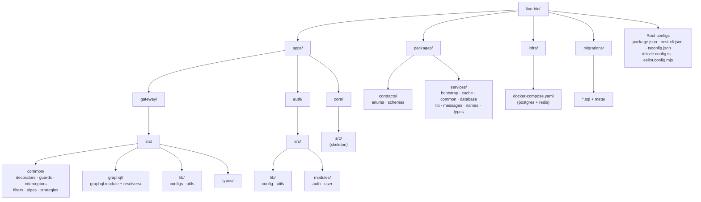
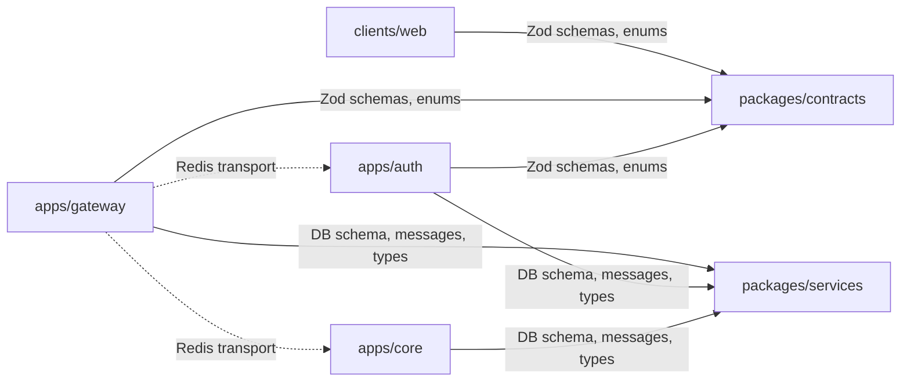
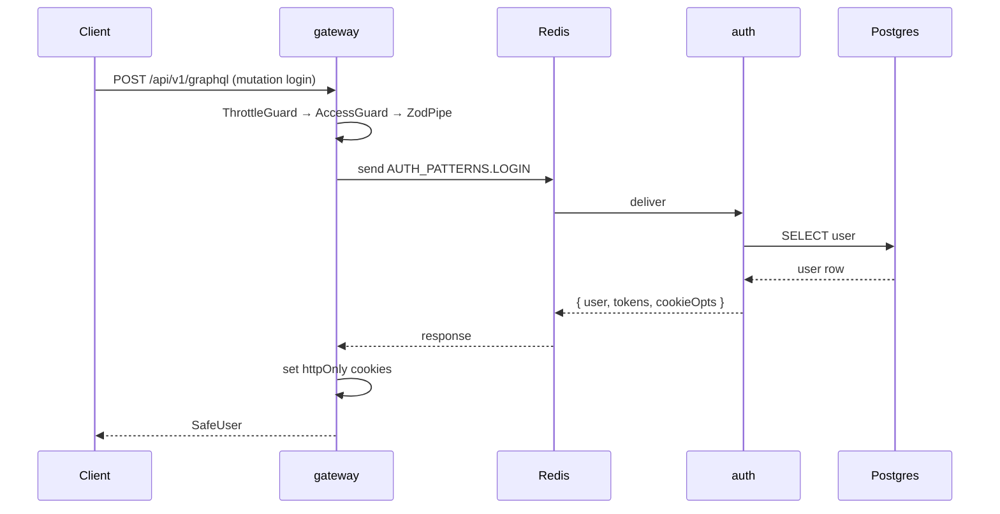

# 📐 `server-structure.md`

```md
# 🗺️ Server Structure

High-level structure of the Live Bid backend — from the monorepo root down to individual services. This is a **map**, not a file listing: it shows *where things live* and *how they
connect*.

> 📖 For setup, environment, and API details, see [`README.server.md`](./README.server.md).
> 📖 For service internals, see [`apps/README.md`](./apps/README.md) and the per-service READMEs.

---

## 🧭 Full Map



---

## 📁 `apps/`

The three NestJS applications. All three share the same bootstrap conventions and consume code from `packages/`.

```
apps/
├── gateway/          → public GraphQL API (HTTP + WebSocket)
├── auth/             → authentication microservice (Redis transport)
└── core/             → domain microservice (Redis transport, WIP)
```

### `apps/gateway/`

Only service with an HTTP server. Owns the GraphQL surface. Talks to `auth` and `core` via Redis. **No direct DB access.**

```
gateway/
├── src/
│   ├── main.ts                    → HTTP bootstrap (port 3001, CORS, helmet, cookies)
│   ├── app.module.ts              → global guards, interceptors, filters
│   ├── app.controller.ts          → root + /health (version-neutral)
│   │
│   ├── common/                    → cross-cutting concerns (all global)
│   │   ├── decorators/            → @Public, @Role, @CurrentUser, @NormalizeClientInfo, @Cacheable, @CacheEvict
│   │   ├── guards/                → ThrottleGuard, AccessTokenGuard, RoleGuard, RefreshGuard
│   │   ├── interceptors/          → CacheableInterceptor, CacheEvictInterceptor
│   │   ├── filters/               → GraphQLExceptionFilter, GatewayException
│   │   ├── pipes/                 → ZodPipe
│   │   └── strategies/            → Passport JWT strategy
│   │
│   ├── graphql/
│   │   ├── graphql.module.ts      → registers Redis ClientProxy for auth + core
│   │   └── resolvers/
│   │       ├── auth/              → login, register, refresh, logout
│   │       └── health/            → health, healthCheck
│   │
│   ├── lib/
│   │   ├── configs/               → env, apollo-driver, throttle, complexity
│   │   └── utils/                 → getReqRes, normalizeClientInfo
│   │
│   └── types/                     → GraphQL-specific types
└── tsconfig.app.json
```

### `apps/auth/`

Redis microservice. Owns `users` + `refresh_tokens` tables. Handles all auth logic. No HTTP.

```
auth/
├── src/
│   ├── main.ts                    → Redis microservice bootstrap
│   ├── app.module.ts              → Config, Logger, Cache, Drizzle, AuthModule
│   │
│   ├── lib/
│   │   ├── config/env.ts          → loads apps/auth/.env
│   │   └── utils/crypto.ts        → bcrypt + SHA-256 + random tokens
│   │
│   └── modules/
│       ├── auth/                  → controller (@MessagePattern) · service · repository · TokenUtil
│       └── user/                  → controller (empty) · service (empty) · cache · repository
└── tsconfig.app.json
```

### `apps/core/`

Redis microservice. **Skeleton only** — boots up, connects to Redis and Postgres, no handlers.

```
core/
├── src/
│   ├── main.ts                    → Redis microservice bootstrap
│   └── app.module.ts              → Config, Logger, Cache, Drizzle (no domain modules)
└── tsconfig.app.json
```

---

## 📦 `packages/`

Code shared between services (and, for `contracts`, with the web client).

```
packages/
├── contracts/           → SHARED WITH CLIENT
│   └── src/
│       ├── enums/       → UserRoleEnum, ...
│       └── schemas/     → Zod schemas (auth, common)
│
└── services/            → BACKEND ONLY
    └── src/
        ├── bootstrap/   → colored startup logs (thenBootstraps, microserviceBootstraps)
        ├── cache/       → Redis cache module + service + key builder
        ├── common/      → DB exception filter
        ├── database/    → Drizzle client · schema · seed · table names
        ├── lib/         → logger config, AppException, role helpers, time
        ├── messages/    → inter-service message patterns (AUTH_PATTERNS, ...)
        ├── names/       → service names + token/cookie names
        └── types/       → request/response DTOs, gateway types
```

### The boundary rule



- **`contracts/`** — anything the **client** needs to know (validation, enums)
- **`services/`** — anything **backend-only** (DB schema, message patterns, internal DTOs)
- **Apps never import from each other's `src/`** — only from `@live-bid/*` packages

---

## 🗄️ `migrations/` & `infra/`

```
migrations/
├── 0000_*.sql              → users table
├── 0001_*.sql              → refresh_tokens table
├── 0002_*.sql              → (indexes / constraints)
└── meta/_journal.json      → drizzle-kit state

infra/
└── docker-compose.yaml     → postgres:16 + redis:7 (dev only)
```

Migrations are generated from `packages/services/src/database/schema/` — **never handwritten**.

---

## 🔄 Request Flow (at a glance)



---

## 🧱 Adding to the Backend

| You're adding…                   | Where it goes                                                                            |
|----------------------------------|------------------------------------------------------------------------------------------|
| A new **GraphQL mutation/query** | `apps/gateway/src/graphql/resolvers/<domain>/`                                           |
| A new **DB table**               | `packages/services/src/database/schema/` → `npm run db:sync`                             |
| A new **Zod schema** (shared)    | `packages/contracts/src/schemas/<domain>/`                                               |
| A new **message pattern**        | `packages/services/src/messages/<service>.messages.ts`                                   |
| A new **request/response type**  | `packages/services/src/types/services-{request,response}/`                               |
| New **business logic**           | `apps/<service>/src/modules/<domain>/`                                                   |
| A **new microservice**           | `apps/<name>/` + `nest-cli.json` + `tsconfig.json` paths + service name + gateway client |

---

## 📚 See Also

- [`README.md`](./README.md) — project overview + client
- [`README.server.md`](./README.server.md) — backend setup, env, DB, API
- [`CONTRIBUTING.md`](./CONTRIBUTING.md) — branch/commit/PR conventions
- [`apps/README.md`](./apps/README.md) — service roles and communication
- [`apps/gateway/README.md`](./apps/gateway/README.md) — GraphQL, guards, caching
- [`apps/auth/README.md`](./apps/auth/README.md) — auth flows, token rotation
- [`apps/core/README.md`](./apps/core/README.md) — core roadmap

```

---

## 📝 Notes

- **Filename suggestion:** `server-structure.md` (root) — sits alongside `README.server.md` and `CONTRIBUTING.md`. If you prefer, `docs/server-structure.md` also works, but the root keeps it discoverable.
- **Mermaid blocks** render natively on GitHub, GitLab, and most Markdown editors (VS Code with extension).
- **Two diagrams** included: a full map (graph TD) and a boundary rule (graph LR) + a request flow (sequence). All are self-contained, no external images needed.
- **No file-by-file listing** — only directories and their **role**, as you asked.
- **Cross-links** point to the READMEs we already wrote, so the doc fits into the existing set.

---

## 🔗 Link it from `README.server.md`

Add one line near the top (after the intro paragraph):

```md
> 🗺️ For a high-level map of the backend (directories, boundaries, request flow), see [`server-structure.md`](./server-structure.md).
```

And optionally in `README.md` (root), under the backend section:

```md
> 🗺️ Backend structure: [`server-structure.md`](./server-structure.md)
```
